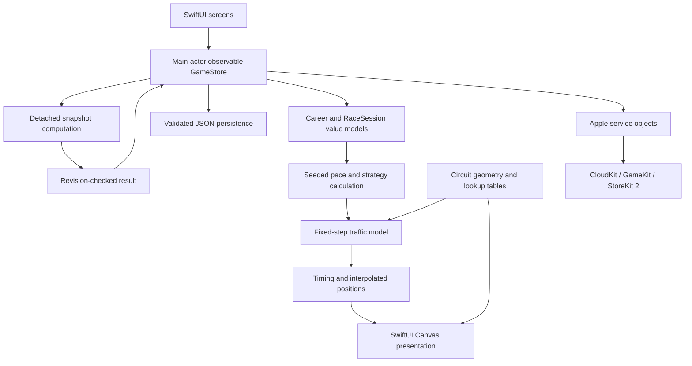

  

# ProjectR: Racing Manager

**A published native iOS game with a custom Swift racing simulation.**

Built and released by [John Money](https://github.com/MoneyJohn). ProjectR combines racing strategy and long-term team management: prepare a driver and car, plan tire stints, respond from the pit wall, and progress through regional championships.

[Download on the Apple App Store](https://apps.apple.com/us/app/projectr-racing-manager/id6830888927) · [Architecture](docs/ARCHITECTURE.md) · [Testing](docs/TESTING.md)

This repository is an engineering showcase for a commercial application. It contains documentation and selected presentation media; the application source, regression executable, purchase implementation, and production configuration remain private. This is not a buildable distribution of the game.

## Engineering highlights

| Engineering problem | Implementation |
| --- | --- |
| Racing decisions need consequences beyond animation | A seeded lap-pace model feeds fixed-step traffic simulation; traffic crossing times contribute to race classification. |
| Overtakes should respect road width and nearby cars | A finite-state traffic model coordinates following, opening selection, lateral movement, passing, merging, and aborted attempts. |
| Preparing a race should not block interaction | Background calculation operates on value snapshots; main-actor state accepts results only when the career revision still matches. |
| Two offline devices can develop different careers | SHA-256 comparison against a shared baseline detects divergence; explicit choices are revalidated before a CloudKit write or restore. |
| Detailed circuit scenery should not redraw with every moving car | Rasterized static scenery, lazy geometry tables, cached traffic runs, and interpolated movement separate preparation from playback. |
| A growing world needs repeatable regression coverage | A custom command-line harness exercises seeded scenarios and sampled invariants, with **3,526,424 assertion evaluations** verified in the regression run. |

## Game scope

ProjectR includes **seven racing tours, 64 distinct locations, and 322 scheduled race weekends**.

The tours are Americas, Europe, India, East Asia, Singapore, China, and World Masters. Each tour schedules 46 championship weekends across five cups. World Masters revisits locations from the regional tours, so tour entries are not additional distinct locations. The 322-weekend figure describes the championship schedule, not 322 independent cities or a claim of 322 unique real-world circuits.

The management loop includes car components and condition, driver contracts and growth, tire planning, rivalries, team history, and championship progression. Race-distance preferences support a minimum of 15 laps and circuit-specific maximums up to 72.

## Architecture at a glance

The app is implemented in one native Xcode application target, with logical boundaries between domain models, state coordination, presentation, and Apple services.

The model can be compiled into the regression harness without SwiftUI. It uses Foundation and geometry types; it is not a separately shipped engine package. [Read the architecture and tradeoffs →](docs/ARCHITECTURE.md)

## Simulation and opponents

Race preparation combines car performance, setup, driver attributes, preparation, tire wear, conditions, and seeded variation. A separate traffic model simulates spatial interactions and pit service before presentation interpolates the resulting samples.

Opponents use **rule-based strategy and adaptive component development**. Teams retain distinct strategy profiles, evaluate stint costs, and develop hardware according to championship context and selected difficulty. Hard difficulty evaluates candidate pit thresholds. These are authored heuristics and bounded planning routines, not machine-learning models.

Player strategy changes rebuild future stint effects from a retained baseline. Completed lap frames and generated rival plans are preserved instead of rerolling the weekend.

## Rendering and concurrency

- SwiftUI Canvas draws circuits and moving cars. Static scenery is rasterized with ImageRenderer and reused through an image cache.
- Geometry samples, road widths, and traffic lookups reduce repeated preparation work. A bounded cache retains recent traffic runs.
- Main race playback uses a Combine timer and monotonic elapsed time. Workshop and podium animations use TimelineView.
- Fixed simulation steps are independent of display scheduling; interpolation supplies intermediate car positions.
- Observable playback state separates frequent car updates from coarser HUD updates.
- Main-actor state ownership, operation gates, revision checks, account-generation checks, and synchronized caches address different concurrency hazards.

These are implemented optimization techniques, not a claim of a measured or sustained display frame rate.

## Persistence and Apple services

**Career integrity.** Codable JSON persistence uses validation, supported-save migrations, atomic file replacement, and pre-restore backups. Interrupted races retain generated timing and strategy inputs. Recovery has limits: the app preserves unreadable files but does not provide a fully automatic backup recovery system.

**CloudKit.** Optional private-database synchronization compares normalized career hashes against the last shared baseline. Divergent careers require a player choice. Before applying it, the app rechecks local content and the server record version; uploads use conditional writes. SHA-256 is used for change detection, not encryption or anti-cheat authentication.

**StoreKit 2.** The app integrates verified transactions, current entitlements, transaction updates, revocation-aware access, and explicit restoration for a non-consumable expansion. Purchase entitlement and championship progression are separate concerns. The commercial purchase implementation is not included here.

**GameKit and AuthenticationServices.** Game Center authentication is refreshed from current framework state; achievement reporting is monotonic and account-aware. Optional Sign in with Apple stores the local profile in Keychain. These services do not form a custom developer-hosted account backend.

## Regression testing

The private project has a custom Swift executable harness that compiles the production model and geometry files with optimization, then checks gameplay scenarios and sampled invariants.

The verified run passed **3,526,424 assertion evaluations**. Roughly 88% come from four road-geometry invariants evaluated repeatedly across sampled points. Additional coverage includes seeded race reproducibility, strategy edits, traffic spacing, career serialization, migrations, progression, driver development, achievement eligibility, and reset-file policy.

This total is a count of assertion evaluations, not independent test cases. The showcase does not include the harness or provide a public CI run. Apple-service integration and physical-device behavior require separate testing. [Read how the harness works →](docs/TESTING.md)

## Gameplay screenshots

Selected native simulator captures in branded presentation frames. These show the actual app UI; they are not physical-device captures or video evidence of animation performance.

<table>
  <tr>
    <th>Race traffic and pit wall</th>
    <th>Pre-race strategy</th>
    <th>Circuit geometry and scenery</th>
  </tr>
  <tr>
    <td></td>
    <td></td>
    <td></td>
  </tr>
</table>

## Production delivery

ProjectR was built and tested through Xcode, distributed through TestFlight, and published on the Apple App Store. It targets iPhone on iOS 17 and later. Apple-service configuration and store submission materials are kept outside this showcase.

**Technology:** Swift · SwiftUI · Swift Concurrency · Observation · Combine · Canvas · TimelineView · CoreGraphics · UIKit · CloudKit · CryptoKit · StoreKit 2 · GameKit · AuthenticationServices · Security/Keychain

## Repository scope

This is a documentation-first portfolio case study of a commercial application. The application source and private assets are not distributed here. No open-source or asset-reuse license is granted.

The technical statements reflect the implementation inspected on **November 18, 2026**. Limitations and evidence boundaries are documented alongside the achievements.
