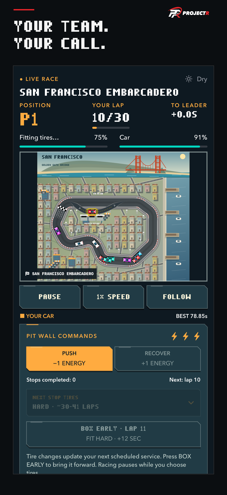
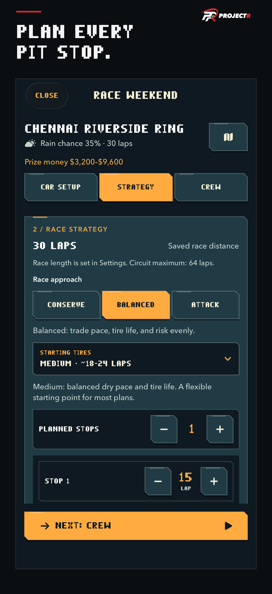
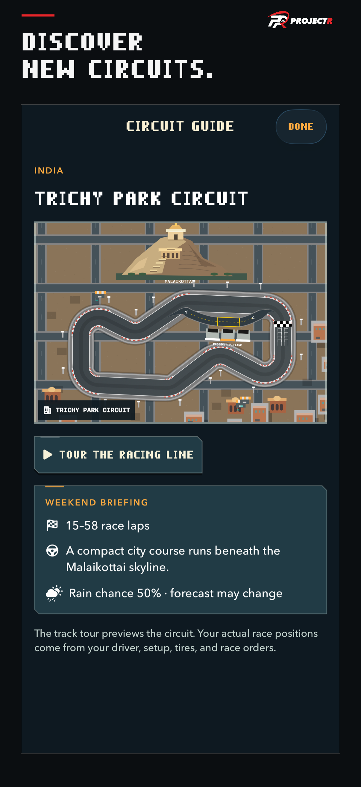

  

# ProjectR: Racing Manager

I’m [John Money](https://github.com/MoneyJohn), a Computer Engineering student. ProjectR is my personal iOS racing management project, now available on the App Store. You run a racing team: choose a car and driver, plan tire stops, make calls during a race, and work through championships.

**[Download ProjectR on the App Store](https://apps.apple.com/us/app/projectr-racing-manager/id6830888927)**

<table>
  <tr>
    <th>Race and pit wall</th>
    <th>Plan your strategy</th>
    <th>Explore circuits</th>
  </tr>
  <tr>
    <td></td>
    <td></td>
    <td></td>
  </tr>
</table>

These are captures of the native app running in the simulator, placed in presentation frames.

## The game

ProjectR is about managing a team over time as well as making decisions during a race. You can:

- Develop cars, manage their condition, and choose drivers with different attributes and growth paths.
- Plan tire compounds and pit stops, then change your approach from the pit wall.
- Race against teams with different strategies and component development that responds to difficulty and career progress.
- Build a team history through championships, rivalries, and driver careers.

There are **seven racing tours, 64 locations, and 322 scheduled race weekends**. The tours are Americas, Europe, India, East Asia, Singapore, China, and World Masters. Each tour has 46 championship weekends; World Masters revisits locations from the other tours. Race length is configurable, from 15 laps to circuit-specific limits of up to 72.

## How I worked on it

I combined hands-on development with substantial AI-assisted coding. AI coding tools helped implement and revise parts of the app, and I also worked directly on implementation, feature decisions, testing, debugging, iteration, and release management. ProjectR has been a way for me to learn by building and maintaining something people can actually play.

For the initial release, I prioritized gameplay logic and functionality. I took the app through Xcode, TestFlight, and App Store release. I plan to keep improving the UI, animations, and gameplay in future updates.

## How it works

### Racing and opponents

The custom Swift simulation calculates lap pace from the car, driver, setup, tires, and race conditions. A separate traffic model handles following, overtaking, merging, and pit service. Cars look for space based on road width and nearby traffic, and their crossing times affect the results.

Opponents have rule-based strategy profiles and develop components as a career progresses. Difficulty changes their planning and development. When the player changes strategy, future laps are rebuilt from saved baseline data so completed laps and rival plans are preserved.

### Drawing the circuits

SwiftUI Canvas draws the scenery and moving cars. Static scenery is rendered to cached images, while car positions are interpolated between simulation samples. Geometry tables and recent traffic runs are cached too. The main race uses timer-driven playback; TimelineView drives animations such as the workshop and podium.

### Background work and game state

An observable GameStore owns application state on the main actor. Race preparation runs on a background task using a copy of the career. Before applying the result, the store checks that the career has not changed in the meantime, so an older calculation cannot replace newer progress.

### Saving and syncing

Careers are saved locally as validated JSON, with migrations for supported older saves and backups before cloud restoration. Optional CloudKit sync stores the career in the player’s private database.

SHA-256 hashes compare career contents with the last shared baseline. If both devices have changed, the player chooses which career to keep. The app checks local contents and the cloud record version again before applying that choice. The hashes detect changes; they do not encrypt the save.

### Apple services

StoreKit 2 handles verified purchases, ownership updates, and restoration for the one-time expansion. Game Center connects the player and reports achievement progress. Optional Sign in with Apple stores a local profile in Keychain. These features use Apple’s services without a separate developer-hosted account backend.

### Regression checks

A local Swift harness compiles the game models and checks race behavior, strategy changes, saving, progression, and circuit geometry. It combines seeded scenarios with repeated checks across track samples. Apple-service integration, UI behavior, and device performance need separate testing.

[Architecture and tradeoffs](docs/ARCHITECTURE.md) · [How the test harness works](docs/TESTING.md)

## Built with

Swift, SwiftUI, Swift Concurrency, Observation, Combine, Canvas, TimelineView, CoreGraphics, UIKit, CloudKit, CryptoKit, StoreKit 2, GameKit, AuthenticationServices, and Keychain. The app targets iPhone on iOS 17 and later.

## About this repository

This is a documentation showcase and technical overview. It does **not** contain the full commercial source code or a runnable version of the project. The application code, private assets, and production configuration remain private. No open-source or asset-reuse license is granted.

The technical notes describe the implementation reviewed on November 18, 2026.
