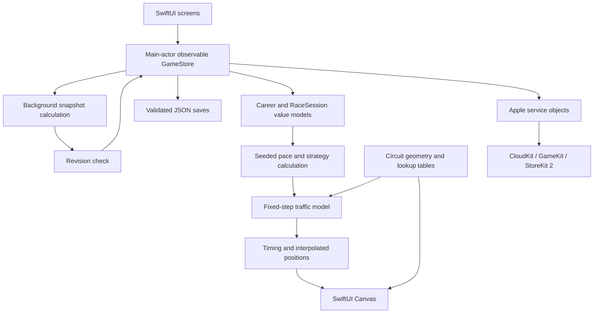

# How ProjectR works

This document explains the app’s current implementation, including the parts that still need work. The type and file names below refer to the private application; their source is not included in this showcase.

## App structure

ProjectR uses one native Xcode application target. Game rules, state management, drawing, and Apple services are separated by types and files within that target, rather than independent Swift packages.

| Part of the app | Types and source files |
| --- | --- |
| Shared state and coordination | `GameStore` in `ProjectRApp.swift` |
| Career rules and race data | `Career`, `RaceSession`, `LapFrame`, `Setup` in `GameModel.swift` |
| Weekend planning and progression | `WeekendPlan`, `RaceStrategy`, `PitWallState` and extensions in `WorldTour.swift` |
| Traffic and overtaking | `TrafficInput`, `TrafficPhase`, `TrafficRun`, `TrafficCache` in `GameModel.swift` |
| Circuit geometry | `CircuitGeometry` and `GeometryCache` in `CircuitGeometry.swift`; `CircuitCatalog.swift` |
| Race screens and playback state | `RaceView` and `RacePlaybackState` in `RaceViews.swift` |
| Drawing and scenery caching | `CircuitArtwork` and `CircuitTextureCache` in `Artwork.swift` |
| Cloud saves, identity, and achievements | `AppleServices` in `AppleServices.swift`; `CareerSnapshot` and `SyncDecision` in `SyncModel.swift` |
| Purchase ownership | `ExpansionStore` in `ExpansionStore.swift` |

SwiftUI receives the observable, main-actor-isolated `GameStore` through the environment. `Career` and `RaceSession` are value types holding game data and rules. Views keep presentation state locally. The model files compile into a test executable without SwiftUI, although they still use Foundation and geometry types.

The store uses concrete service objects, and several model files are large. This keeps related work together but makes replacing dependencies for tests harder. The app has logical layers, not enforced package boundaries or a separate engine module.

## From race preparation to moving cars

### Pace and strategy

`Career.qualify` produces the grid and cumulative lap times. Car performance and condition, setup, driver attributes and preparation, tires, difficulty, conditions, and seeded variation all contribute.

`RivalRaceStrategy` keeps distinct team profiles and estimates the cost of different stints. Hard difficulty evaluates candidate pit thresholds. `RivalDevelopment` retains component development across championship weekends, while driver growth uses experience, training, and milestone traits.

Opponent behavior is rule-based, with no machine-learning model. Weather is selected for the weekend rather than changing continuously during a race.

### Traffic

`TrafficRun` takes intended lap durations and pit schedules and simulates ten cars at a fixed **0.25-second step**. Cars move through states for following, seeking an opening, pulling out, running alongside, merging, abandoning a pass, and pitting.

Road width and upcoming bends determine where a pass is possible. Nearby cars affect lane choice, spacing, braking, steering, and merging. Pit service is part of this movement. `RaceSession.applyTraffic` uses finish-line crossing times to update future classification frames, so traffic affects results as well as appearance.

This is an arcade model built from tuned rules and constraints, rather than a full vehicle-physics simulation. The regression sweeps exercise spacing and movement but cannot prove correctness for every possible input.

### Playback

`TrafficRun.at` interpolates between traffic samples. `RaceSession.positions` maps playback progress to model time and car positions. A Combine timer advances the race display using monotonic elapsed time; it does not recalculate the entire simulation on each display update.

TimelineView supplies animation schedules for the workshop, circuit guide, and podium where used. Display scheduling and the traffic timestep are separate. Requested update intervals do not establish a measured frame rate.

## Changing strategy during a race

`PitWallState` retains baseline frames alongside the stop and command plan. `RaceSession.queue`, `advanceStrategyLap`, and `rebuildStints` update future stint effects while keeping revealed laps intact. Rival plans and baseline incidents are retained rather than randomly regenerated after each command.

Saved sessions keep generated frames, strategies, and traffic inputs. They can resume without rerolling the weekend, but they are not a seed-only replay format that guarantees reconstruction across app versions.

## Background work and state checks

`GameStore.qualifyWeekend` and `editRace` copy their inputs and run CPU work in detached tasks. When the work finishes, the main-actor store accepts it only if the career revision still matches the one captured at the start.

Different checks cover different situations:

| Mechanism | What it prevents or reduces |
| --- | --- |
| Main-actor state | Concurrent access to isolated application and presentation state |
| Preparation gate | Overlapping race preparation or editing |
| Career revision | Applying an old calculation after the career has changed |
| Cloud operation gate | Overlapping sync decisions |
| Account-generation checks | Applying cloud responses from an earlier account or sync session |
| Game Center player checks | Applying achievement responses to a different authenticated player |
| Cancellable debounce tasks | Repeated sync requests after closely spaced local changes |
| NSLock-protected caches | Concurrent dictionary access in shared geometry and traffic caches |

Main-actor code can still suspend at an await, allowing other changes before it resumes. That is why revision and identity checks are needed as well as actor isolation.

The caches do expensive construction outside their locks, then recheck before inserting. This avoids holding a lock during calculation, but two simultaneous misses can do duplicate work. The project uses Swift 5 language mode and has not had a complete Swift 6 strict-concurrency audit. There are no custom actor types in the app.

## Drawing and caching

`CircuitGeometry` rounds authored corners and creates approximately equal-distance samples around each route. Geometry and width tables are built lazily. Traffic runs precompute bend and passing-opening lookups for use in their simulation loops.

`CircuitArtwork` separates scenery from the moving-car Canvas. `CircuitTextureCache` renders static scenery with ImageRenderer and stores it in NSCache, configured for 24 MiB of cost and 16 images. A separate cache retains three recent traffic runs. Car playback updates more often than the HUD’s coarser progress values.

The tradeoffs are memory for full-race samples and retained geometry tables, possible first-use scenery work on the main actor, and NSCache limits that guide eviction rather than enforce a hard memory ceiling. Device frame-time and battery profiling are still needed.

## Local saves and CloudKit

Careers use Codable JSON. Loading validates supported formats, ranges, identities, finite timing values, and race/progression structure, then applies supported migrations. Writes use atomic file replacement and iOS file protection. Before restoring a cloud career, the app validates it and backs up the current local file.

Optional sync uses a private CloudKit database. SHA-256 hashes compare normalized, sorted-key career JSON; snapshot timestamps and device descriptions are excluded from that comparison. The baseline represents the last career shared by the device and cloud.

| Save comparison | Action |
| --- | --- |
| Local and remote match | No transfer |
| Only local exists | Upload |
| Only remote exists | Download |
| Both exist without a baseline | Ask the player |
| Only local changed from the baseline | Upload |
| Only remote changed from the baseline | Download, subject to active-race protection |
| Both changed from the baseline | Ask the player |

Before applying a choice, `AppleServices.resolve` checks the local hash, fetches the latest cloud record, checks the local hash again, and compares server record change tags. Uploads use conditional writes. If another device changed the record, the player needs to review the saves again.

The app selects a whole career rather than merging individual fields or choosing by timestamp. SHA-256 detects content changes; it does not encrypt or authenticate a save.

## Apple services

StoreKit 2 handles the non-consumable expansion through verified transactions, current entitlements, transaction updates, revocation-aware access, and restoration. GameKit authentication is refreshed from current player state at launch and on returning to the app. Achievement reporting checks the player account and only increases platform progress. Optional Sign in with Apple stores a local profile in Keychain.

The iCloud account, Game Center player, and optional Apple profile have separate roles. They are not a custom unified account system. Purchase implementation and production configuration remain outside this repository.

## Limits and possible next steps

- Resuming uses the last successfully saved checkpoint; within-lap view progress is not persisted.
- A failed local write shows an error but does not roll back the in-memory career.
- Unreadable files are preserved on a best-effort basis. There is no automatic backup-selection screen.
- Cloud sync retries on later app activity; it has no durable background worker.
- Growing career files need continued evaluation against the cloud snapshot size limit.
- Injectable service interfaces would make network and transaction failure tests easier to automate.
- Strict-concurrency checks, lifecycle/UI tests, and physical-device profiling would add coverage beyond the model harness.

These are limitations and possible improvements, not completed work.
